# Software & Hardware Design Description (SDD) — SM-5800 6-DOF IMU Subsystem

| Thuộc tính | Giá trị |
|---|---|
| **Mã tài liệu** | `SDD-SM5800-001` |
| **Phiên bản** | `1.1.0` |
| **Ngày lập** | `2026-11-19` |
| **Tài liệu nguồn** | `LLR_SM5800.md` (`LLR-SM5800-001`), *SM-5800 User's Manual* |
| **Kiến trúc mục tiêu** | Xilinx Zynq-7000 / UltraScale+ (FPGA PL AXI4-Lite IP + ARM Cortex-A Bare-Metal PS Driver) |

---

## 1. Kiến trúc tổng thể Hệ thống (FPGA PL + ARM PS)

### 1.1 Sơ đồ khối tổng thể (`SDD-SM5800-1.0`)

```mermaid
flowchart LR
    IMU["SM-5800 6-DOF IMU (RS-422 / OC)"]
    CLK["u_clk_ctrl (1MHz RCV_CLK, 2-FF Sync, RESET_L/BIT_L)"]
    SDLC["u_sdlc_rx + u_crc16 (Flag 0x7E, Destuff, CRC-16)"]
    PARSE["u_msg_parser (Msg 01 / 02 Filter, Watchdog)"]
    AXI["u_axi4_lite_if (AXI4-Lite Slave, SNAP_LOCK, IRQ)"]
    PS_HAL["sm5800_hal (MMIO, DMB/DSB, Crit)"]
    PS_DRV["sm5800_drv (100Hz Msg02 IRQ + Raw-to-Eng + Reset/BIT)"]
    PS_APP["PS Application / Control Law"]

    CLK -->|"imu_rcv_clk_o, imu_bit_l_o, imu_reset_l_o"| IMU
    IMU -->|"imu_ser_data_i (1MHz NRZ)"| CLK
    CLK -->|"rx_bit_valid, rx_bit"| SDLC
    SDLC -->|"rx_byte, frame_end, crc_ok, flag_det"| PARSE
    PARSE -->|"msg1_valid_o, msg2_valid_o, Live 14 Fields"| AXI
    AXI -->|"CTRL / Reset / BIT / MSG2_ONLY"| CLK
    AXI -->|"irq_o (100Hz Msg 02)"| PS_DRV
    AXI <-->|"AMBA AXI4-Lite 32-bit"| PS_HAL
    PS_HAL <--> PS_DRV
    PS_DRV <--> PS_APP
```



### 1.2 Sơ đồ trình tự hoạt động 100 Hz (Message ID 02) & Phục hồi lỗi Reset/BIT

```mermaid
sequenceDiagram
    participant IMU as SM-5800 IMU
    participant PL as FPGA IP (MSG2_ONLY=1)
    participant GIC as PS GIC / ISR
    participant PS as PS Main Task

    Note over PL,PS: 1. Khởi tạo: sm5800_init() kiểm tra PDI CRC-32 + CORE_ID, bật MSG2_ONLY & INT_ENABLE=0x26
    IMU->>PL: Msg ID 01 (600 Hz, 20B)
    PL->>PL: Parse & đếm msg1_rx_cnt, xuất msg1_valid_o (KHÔNG ghi đè thanh ghi, KHÔNG ngắt PS)
    IMU->>PL: Msg ID 02 (100 Hz, 44B: 16B MC + 24B Spatial + 2B CRC)
    PL->>PL: Verify Addr=0x0A, Len=44B, CRC=0xF0B8 -> Atomic commit 14 trường, xuất msg2_valid_o
    PL->>GIC: Assert irq_o (INT_STATUS[1] = MSG2_READY)
    GIC->>PL: sm5800_irq_isr(): Đọc & xóa W1C INT_STATUS + DSB; đặt is_msg2_pending = true
    PS->>PL: sm5800_read_msg2_eng(): Ghi CTRL.SNAP_LOCK=1 + DSB
    PS->>PL: Đọc đồng bộ 15 thanh ghi raw (0x20..0x54, 0x1C)
    PS->>PL: Ghi CTRL.SNAP_LOCK=0 + DSB; quy đổi SI (rad/s, m/s^2, rad, m/s, degC)
    alt Phát hiện has_module_failed == true
        PS->>PL: sm5800_trigger_reset(): Ghi CTRL.RST_PULSE=1
        PL->>IMU: Kéo RESET_L = 0 trong > 1.0 ms (2.0 ms), sau đó nhả Hi-Z
    else Phát hiện bit_fault_mask != 0
        PS->>PL: sm5800_start_cmd_bit() -> giữ >= 200 ms -> sm5800_stop_cmd_bit()
        PL->>IMU: Kéo BIT_L = 0 (SM-5800 chỉ phát cờ 0x7E), nhả BIT_L = 1 để nhận kết quả BIT
    end
```

---

## 2. Thiết kế chi tiết Khối FPGA PL (`SDD-SM5800-1.x`)

### 2.1 `SDD-SM5800-1.1` — `sm5800_clk_ctrl` (`rtl/sm5800_clk_ctrl.v`)
- **Miền xung nhịp đơn (`s_axi_aclk`):** Không tạo miền xung nhịp phân nhánh hay gated clock. Xung `imu_rcv_clk_o` được tạo bằng bộ đếm đồng bộ `P_CLK_PERIOD_INT = C_CLK_FREQ_HZ / C_SDLC_CLK_HZ` (`100` chu kỳ ở 100 MHz → `1.000 MHz` chính xác, duty `50/50`).
- **Đồng bộ hóa ngõ vào bất đồng bộ:** `imu_ser_data_i` đi qua chuỗi 2 tầng flip-flop gắn thuộc tính `(* ASYNC_REG = "TRUE" *)` trước khi được lấy mẫu tại sườn lên (`sample_edge_i = 0`, trễ 500 ns sau sườn xuống — biên độ mắt dữ liệu > 350 ns sau trễ vòng 26C31/26C32) hoặc sườn xuống (`sample_edge_i = 1`).
- **Điều khiển `RESET_L` & `BIT_L` (Open-Collector):**
  - Khi FPGA reset (`s_axi_aresetn = 0`), cả `imu_reset_l_o` và `imu_bit_l_o` thả về mức `1` (open-collector Hi-Z) để cảm biến tự reset khi cấp nguồn (Sec. 4.4).
  - Xung `reset_pulse_req_i` nạp bộ đếm `C_RESET_PULSE_US + 1` (mặc định `2001 µs`), đảm bảo độ rộng mức thấp luôn **nghiêm ngặt > 1.0 ms** bất kể pha của `tick_1us_r`.

### 2.2 `SDD-SM5800-1.2` — `sm5800_crc16_ccitt` (`rtl/sm5800_crc16_ccitt.v`)
- Đa thức CCITT: $G(x) = x^{16} + x^{12} + x^5 + 1$, dạng phản xạ LSB-first là `16'h8408`, khởi tạo `16'hFFFF`.
- Bước dịch bit nối tiếp:
  $$\text{fb} = \text{crc}[0] \oplus \text{bit}_{\text{in}}, \quad \text{crc}_{\text{next}} = (\text{crc} \gg 1) \oplus (\text{fb} ? \text{0x8408} : \text{0x0000})$$
- Xuất đồng thời `crc_o` (thanh ghi) và `crc_next_o` (tổ hợp) để `sm5800_sdlc_rx` kiểm tra residue ngay trên chu kỳ nhận bit cuối cùng trước cờ đóng `0x7E`.
- Chuẩn Z8530 SCC / ISO 3309 đảo FCS trước khi phát (`~crc`), nên residue hợp lệ phía thu là **`16'hF0B8`** (`crc_mode_i = 0`); chế độ FCS không đảo cho residue **`16'h0000`** (`crc_mode_i = 1`).

### 2.3 `SDD-SM5800-1.3` — `sm5800_sdlc_rx` (`rtl/sm5800_sdlc_rx.v`)
- **Giải pháp Lookahead 8-bit chống nhiễm cờ đóng:** Dùng thanh ghi dịch thô `raw_sr_r[7:0]` làm hàng đợi trễ 8 bit thô (`next_raw_w = {rx_bit_i, raw_sr_r[7:1]}`, bit ra ở đuôi `out_bit_w = raw_sr_r[0]`).
  - Khi `next_raw_w == 8'h7E`: toàn bộ 8 bit của cờ đóng nằm trọn trong `next_raw_w`, còn `out_bit_w` chính là bit cuối cùng của khung trước đó (hoặc bit `0` chèn cuối cùng). Vì vậy **không một bit nào của cờ đóng lọt vào bộ ghép byte hay bộ tính CRC**.
  - Sau mỗi cờ `0x7E`, `skip_cnt_r <= 4'd8` xả đúng 8 bit cờ ra khỏi `raw_sr_r`.
  - Hỗ trợ liền mạch: cờ rảnh liên tiếp (`7E 7E ...`), cờ 7-bit dùng chung bit `0`, và **Shared Flag** giữa 2 khung liên tiếp.
  - Phát hiện Abort/Idle khi `next_raw_w[7:1] == 7'b111_1111` (≥ 7 bit `1`). Chỉ dựng `frame_abort_o` nếu đang giữa khung có dữ liệu (`has_bits_r == 1`); trạng thái rảnh sau cờ đóng không gây báo lỗi giả.
  - Đảm bảo `frame_end_o` xuất **trễ đúng 1 chu kỳ xung nhịp sau `rx_byte_valid_o`** của byte cuối (qua tầng trễ `frame_end_d1_r`), loại bỏ hoàn toàn tranh chấp (race) tại khối parser.

### 2.4 `SDD-SM5800-1.4` — `sm5800_msg_parser` (`rtl/sm5800_msg_parser.v`)
- **Tách Staging vs Live:** Toàn bộ byte thu được lắp ghép Little-Endian vào thanh ghi tạm `stg_*`. Chỉ khi `frame_end_i == 1` và thỏa mãn đồng thời 4 điều kiện (`!frame_align_err_i`, `crc_pass_w`, `stg_addr_r == 8'h0A`, đúng cặp `(ID=01, Len=20B)` hoặc `(ID=02, Len=44B)` không tràn) mới được coi là khung hợp lệ.
- **Phân biệt đầu ra & lọc chế độ 100 Hz:**
  - `msg1_valid_o` phát xung duy nhất cho **Msg ID 01**; `msg2_valid_o` phát xung duy nhất cho **Msg ID 02**.
  - Ở chế độ 100 Hz (`msg2_only_mode_i == 1`): chỉ **Msg ID 02** commit nguyên tử cả 14 trường (Motion Control + Spatial + Status Word 1/2 + Timestamp) và reset bộ đếm watchdog. Msg ID 01 vẫn xuất `msg1_valid_o`, tăng `msg1_rx_cnt_o`, và cập nhật bộ đếm tuần tự 4-bit `prev_seq_cnt_r` (tránh lỗi giả `SEQ_GAP` vì SM-5800 tăng counter ở cả Msg 1 và Msg 2).

### 2.5 `SDD-SM5800-1.5` — `sm5800_axi4_lite_if` (`rtl/sm5800_axi4_lite_if.v`)
- **Máy trạng thái ghi độc lập AW/W:** Lưu độc lập cờ `aw_captured_r` và `w_captured_r`. Các tín hiệu `s_axi_awready`, `s_axi_wready`, `s_axi_arready` đều là ngõ ra thanh ghi (0 đường tổ hợp từ `*VALID`), tránh deadlock trên AXI Interconnect.
- **Cơ chế Snapshot `CTRL.DATA_LOCK`:** Trên sườn lên `0 → 1` của `CTRL[1]`, toàn bộ 16 thanh ghi dữ liệu + timestamp được chốt đồng thời vào `shd_*_r`. Khi `DATA_LOCK == 0`, bộ chọn đọc đi thẳng từ `live_*_i` (độ trễ 0 chu kỳ).
- **Ngắt W1C không mất sự kiện:** `int_status_r <= (int_status_r & ~sw_w1c_mask_w) | hw_int_events_w;` đảm bảo xung phần cứng mới đến cùng chu kỳ với lệnh xóa phần mềm không bị nuốt mất.
- **Tái kích `irq_o` (re-arm):** mọi lần ghi W1C vào `INT_STATUS` ép `irq_o` xuống 0 trong 1 chu kỳ; nếu còn cờ được cho phép (đến trước hoặc trong lúc ISR chạy), `irq_o` lên lại tạo cạnh mới. Nhờ vậy GIC cấu hình kích cạnh (`0x03`) không bị kẹt `irq_o = 1` vĩnh viễn; GIC kích mức (`0x01`) không bị ảnh hưởng.
- **Khoảng ân hạn watchdog theo datasheet (`sm5800_msg_parser`):** `wd_grace_us_r` = `C_ACTIVATION_GRACE_US` sau reset/soft-reset/nhả `RESET_L`, = max(hiện tại, `C_BIT_GRACE_US`) khi nhả `BIT_L`, về 0 ở khung hợp lệ đầu tiên; watchdog hết hạn khi `idle ≥ TIMEOUT_CFG + wd_grace_us_r` (phép cộng 33 bit, không tràn).

---

## 3. Thiết kế chi tiết Phần mềm lớp PS (`SDD-SM5800-2.x` – `4.x`)

### 3.1 `SDD-SM5800-2.1` — Bản đồ thanh ghi (`driver/sm5800_regs.h`)
Mọi trường bit được định nghĩa thuần bằng cặp `_MASK` / `_SHIFT` kiểu không dấu (`U`), tuyệt đối không dùng C bit-field để tránh phụ thuộc trình biên dịch.

### 3.2 `SDD-SM5800-2.2` — Lớp HAL (`driver/sm5800_hal.h` / `.c`)
- **Cô lập phần cứng tại biên module:** `sm5800_drv.c` không dùng `#ifdef`. Chỉ `sm5800_hal.c` chọn tập lệnh theo trình biên dịch: `__aarch64__` cho **Cortex-A53 (Zynq UltraScale+ APU)**, `__arm__` cho **Cortex-A9 (Zynq-7000)** và **Cortex-R5 (RPU)**; CPU khác dừng build bằng `#error`. Môi trường Unit Test trên PC thay file `.c` bằng mock HAL ở bước liên kết.
- **Chi tiết hàm (`2.2.1`–`2.2.6`):**
  - `2.2.1` / `2.2.2`: `sm5800_hal_read_reg()` / `sm5800_hal_write_reg()` — nơi duy nhất thực hiện ép kiểu `uintptr_t → volatile uint32_t *` (ghi nhận ngoại lệ `DEV-001` cho MISRA 11.4).
  - `2.2.3` / `2.2.4`: `sm5800_hal_dmb()` / `sm5800_hal_dsb()` — rào cản bộ nhớ ARM `dmb sy` / `dsb sy`, dùng được cho cả ARMv7 và AArch64 (`DEV-002`) đảm bảo đồng bộ dữ liệu ISR ↔ Main và xả đường ống ghi AXI4-Lite trước khi thoát ISR.
  - `2.2.5`: `sm5800_hal_enter_crit()` / `sm5800_hal_exit_crit()` — ARMv7: đọc `CPSR`, tắt IRQ bằng `cpsid i`, chỉ bật lại `cpsie i` nếu IRQ đang mở trước khi vào; AArch64: đọc `DAIF`, tắt bằng `msr daifset, #2`, bật lại bằng `msr daifclr, #2` (bit I đều là bit 7; hỗ trợ lồng nhau an toàn).
  - `2.2.6`: `SM5800_ASSERT(expr)` — biên dịch thành `((void)0)` khi không bật `SM5800_ENABLE_ASSERT` để đạt 100% phủ MC/DC ở bản release.

### 3.3 `SDD-SM5800-3.0` – `3.2` — Kiểu dữ liệu, SEU & Tính toàn vẹn PDI (`driver/sm5800_drv.h`)
- **Chống lật bit SEU (`SDD-SM5800-3.1`):** Trạng thái `sm5800_state_t` sử dụng mẫu 31-bit dương (tương thích `-std=c99 -pedantic-errors` trên ARM 32-bit):
  - `SM5800_STATE_UNINIT = 0x25C3691E`
  - `SM5800_STATE_READY  = 0x5A3C16E1` (khoảng cách Hamming = **30 bit** so với `UNINIT`)
  - `SM5800_STATE_FAULT  = 0x3C5A916E` (khoảng cách Hamming = **15 bit** với `UNINIT` và **17 bit** với `READY`)
- **Định dạng tuần tự hóa PDI CRC-32 (`SDD-SM5800-3.2`, `3.3.1`, `3.4.1`–`3.4.4`):**
  Để tránh lỗi căn chỉnh/padding struct (MISRA Rule 11.3), `sm5800_config_t` được tuần tự hóa tường minh ra đúng **19 byte** Little-Endian trước khi tính IEEE 802.3 CRC-32 (`0xEDB88320U`):

| Byte offset | Trường | Độ rộng | Ghi chú |
|---|---|---|---|
| `0..3` | `schema_version` | 4 B LE | Bắt buộc bằng `0x00010100U` |
| `4..11` | `base_addr` | 8 B LE | Mở rộng `uint64_t` tương thích 32/64-bit |
| `12..15` | `timeout_us` | 4 B LE | Phạm vi `12000..1000000` µs |
| `16` | `is_falling_edge` | 1 B | `0x01` hoặc `0x00` |
| `17` | `is_raw_crc_mode` | 1 B | `0x01` hoặc `0x00` |
| `18` | `is_msg2_only` | 1 B | `0x01` (100 Hz) hoặc `0x00` |

### 3.4 `SDD-SM5800-3.3` & `3.4` — Thiết kế API, Quy đổi vật lý & Concurrency (`driver/sm5800_drv.c`)
- **Phân tách sở hữu thanh ghi ISR vs Main:**
  - `sm5800_irq_isr()` (`3.3.4`) **chỉ** truy cập `INT_STATUS` (đọc & xóa W1C) và cập nhật biến `volatile` (`is_msg2_pending`, `isr_msg2_count`, `isr_fault_flags`) — không bao giờ ghi `CTRL`, không dùng dấu phẩy động, độ phức tạp O(1).
  - Các hàm tác vụ (`sm5800_read_msg2_raw/eng`, `sm5800_trigger_reset`, `sm5800_hold/release_reset`, `sm5800_start/stop_cmd_bit`, `sm5800_clear_diag`) cập nhật cờ chia sẻ với ISR và `ctrl_shadow` trong vùng găng `enter_crit`/`exit_crit`.
- **Giải mã bù 2 không Undefined Behavior (`3.4.6`–`3.4.8`):**
  - 16-bit (`decode_s16_lsb`): với `low_bits >= 0x8000U`, tính `-((int32_t)(0x10000U - low_bits))` (xử lý an toàn `-32768`).
  - 32-bit (`decode_s32_lsb`): với `reg_word >= 0x80000000U`, tính `(int32_t)((int64_t)reg_word - INT64_C(4294967296))` (xử lý an toàn `INT32_MIN`).
- **Hàm 1-lệnh-gọi quy đổi SI (`3.3.7`, `3.3.8`, `3.4.11`):**
  - `sm5800_read_msg2_eng()` khóa snapshot phần cứng → gọi `read_locked_msg2_raw()` → nhả khóa ngay → gọi `convert_raw_to_eng()`.
  - Hệ số quy đổi chuẩn từ SM-5800 Sec. 5.2.1 & 5.2.2 (`1 ft = 0.3048 m` chính xác):
    - `rate_*_rad_s` = `lsb * 5.722045898e-4f` ($2^{-20} \times 600\ \text{rad/s}$)
    - `accel_*_m_s2` = `lsb * 0.011162109375f` ($2^{-14} \times 600 \times 0.3048\ \text{m/s}^2$)
    - `delta_ang_*_rad` = `(float)((double)lsb * 1.1641532182693481e-10)` ($2^{-33}\ \text{rad}$, nhân bằng `double` rồi làm tròn 1 lần sang `float`)
    - `delta_vel_*_m_s` = `(float)((double)lsb * 2.2709369659423828e-9)` ($2^{-27} \times 0.3048\ \text{m/s}$, như trên)

### 3.5 Phân tích đồ thị gọi hàm (Call Graph) & Ngân sách Ngăn xếp (WCSU — DO-178C §6.3.4f)
- **Không đệ quy, không con trỏ hàm động:** Toàn bộ đồ thị gọi hàm tĩnh, xác định 100% tại thời điểm biên dịch.
- **Kích thước biến cục bộ cực đại trên stack (độ sâu gọi lớn nhất = 3 tầng):**
  - `main()` → `sm5800_read_msg2_eng()` (`sm5800_msg2_raw_t`: `56 B`) → `sm5800_read_msg2_raw()` → `read_locked_msg2_raw()` (`16 × uint32_t`: `64 B`) → `sm5800_hal_read_reg()` (`8 B`).
  - Mỗi khung hàm đơn lẻ đều dưới `128 B` (khuyến nghị kiểm chứng với `-Wstack-usage=256 -fstack-usage`), mọi buffer cục bộ đều **≤ 64 byte** (`sm5800_msg2_raw_t = 56 B`, `sm5800_msg2_eng_t = 60 B`, `serial_octets = 19 B`).

### 3.6 `SDD-SM5800-4.0` – `4.7` — Ứng dụng mẫu PS (`driver/sm5800_ps_example.c`)
- `4.0`–`4.2`: Khởi tạo tĩnh handle, vòng lặp đọc có cận trên `APP_MAX_POLL_CYCLES`.
- `4.1` (`init_irq_path`, `service_irq_polling`): nối `irq_o` → GIC → `sm5800_ps_gic_isr()` bằng driver `XScuGic` khi có Xilinx BSP (tự nhận biết bằng `__has_include("xscugic.h")`, hỗ trợ cả luồng SDT), kích mức cao vì `irq_o` giữ mức 1 đến khi W1C. Gọi sau `sm5800_init()` để ISR đã sẵn sàng. Không có BSP hoặc `APP_FORCE_IRQ_POLLING`: polling `INT_STATUS` trong vòng lặp chính (dùng để phân biệt lỗi nối dây ngắt với lỗi IP/cảm biến).
- `4.3` (`init_imu_100hz`): Tạo PDI `is_msg2_only = true`, tính CRC-32 và gọi `sm5800_init()`.
- `4.4` (`handle_msg2_and_faults`, `is_rate_plausible`): mẫu có tốc độ quay bão hòa (|ω| ≥ 18.5 rad/s ở bất kỳ trục nào; full-scale 16-bit = 18,75 rad/s) bị loại, đếm vào `g_rate_reject_count` và không ghi đè mẫu tốt gần nhất. Ngưỡng cần thay bằng dải đo định mức trong datasheet SM-5800.
- `4.4` & `4.6` (`run_commanded_bit_cycle`): Tự động ra lệnh `RESET_L > 1 ms` khi `has_module_failed == true`, hoặc chạy chu trình **Commanded BIT (`BIT_L`)** khi phát hiện cờ `bit_fault_mask != 0`.
- `4.5` (`verify_raw_to_eng_math`): Tự kiểm chứng toán học phép quy đổi `sm5800_raw_to_eng_msg2()` với vector `1 g` bằng ngưỡng khoảng (`9.75f .. 9.86f`), không so sánh bằng `==` trên `float`.
- `4.7` (`handle_link_faults`) & `3.3.19` (`sm5800_take_irq_faults`): FPGA báo `LINK_TIMEOUT` khi cảm biến im lặng (kể cả ngay sau bật nguồn); ISR chốt cờ vào `isr_fault_flags`, vòng lặp chính lấy-và-xóa cờ trong vùng găng rồi phát xung `RESET_L` để khởi động lại cảm biến, tối đa 3 lần liên tiếp.

---

## 4. Ma trận truy vết hai chiều (Bi-Directional Traceability Matrix)

| HLR | LLR | SDD | Tệp nguồn triển khai | Kịch bản kiểm chứng |
|---|---|---|---|---|
| `HLR-SM5800-01` | `LLR-SM5800-RTL-001` | `SDD-SM5800-1.1` | `rtl/sm5800_clk_ctrl.v` | `[T1]`–`[T4]` |
| `HLR-SM5800-03` | `LLR-SM5800-RTL-002`, `003` | `SDD-SM5800-1.1` | `rtl/sm5800_clk_ctrl.v` | `[T9]`, `[T10]` |
| `HLR-SM5800-01` | `LLR-SM5800-RTL-004` | `SDD-SM5800-1.2` | `rtl/sm5800_crc16_ccitt.v` | Bit-exact PS, `[T3]`, `[T4]`, `[T7]` |
| `HLR-SM5800-01` | `LLR-SM5800-RTL-005` | `SDD-SM5800-1.3` | `rtl/sm5800_sdlc_rx.v` | Bit-exact PS, `[T2]`–`[T4]`, `[T7]` |
| `HLR-SM5800-02` | `LLR-SM5800-RTL-006`–`009` | `SDD-SM5800-1.4` | `rtl/sm5800_msg_parser.v`, `rtl/sm5800_imu_axi_top.v` | `[T3]`–`[T8]`, `[T11]`–`[T18]` |
| `HLR-SM5800-02`, `04` | `LLR-SM5800-RTL-010`–`012` | `SDD-SM5800-1.5` | `rtl/sm5800_axi4_lite_if.v` | `[T1]`, `[T3]`, `[T4]`, `[T6]`, `[T12]`, `[T13]` |
| `HLR-SM5800-02` | `LLR-SM5800-REG-001` | `SDD-SM5800-2.1` | `driver/sm5800_regs.h` | Static Audit, `TC-DRV-01` |
| `HLR-SM5800-05` | `LLR-SM5800-HAL-001`–`006` | `SDD-SM5800-2.2.1`–`2.2.6` | `driver/sm5800_hal.h`, `driver/sm5800_hal.c` | Static Audit, `DEV-001/002`, `TC-DRV-01` |
| `HLR-SM5800-04`, `05` | `LLR-SM5800-DRV-001`–`008` | `SDD-SM5800-3.0`–`3.2` | `driver/sm5800_drv.h` | Static Audit, `TC-DRV-02`–`08` |
| `HLR-SM5800-02`–`05` | `LLR-SM5800-DRV-010`–`028` | `SDD-SM5800-3.3.1`–`3.3.19` | `driver/sm5800_drv.h`, `driver/sm5800_drv.c` | `TC-DRV-01`–`TC-DRV-17` |
| `HLR-SM5800-04`, `05` | `LLR-SM5800-DRV-030`–`041` | `SDD-SM5800-3.4.1`–`3.4.12` | `driver/sm5800_drv.c` | `TC-DRV-01`–`TC-DRV-15` |
| `HLR-SM5800-03`, `04` | `LLR-SM5800-APP-001`–`008` | `SDD-SM5800-4.0`–`4.7` | `driver/sm5800_ps_example.c` | `TC-DRV-16`, `TC-DRV-17`, HIL |
